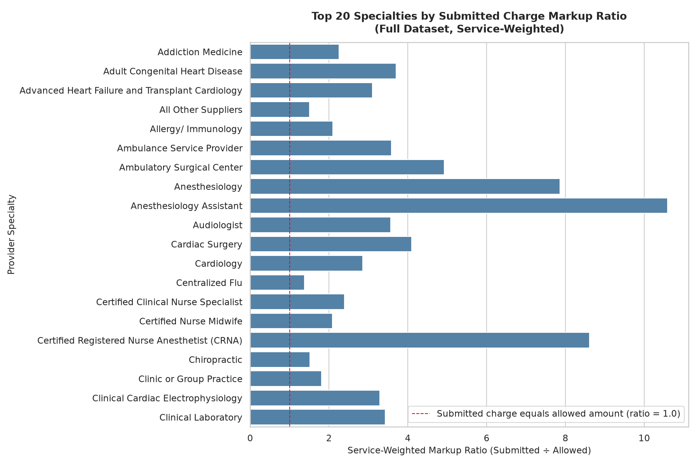
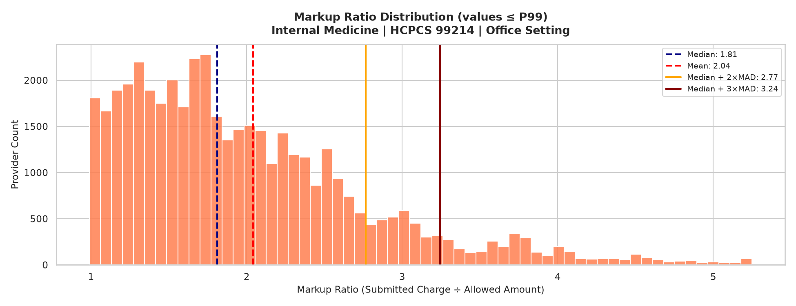

# Healthcare Provider Performance & Outlier Analysis Pipeline

This is an **ongoing ELT data engineering project** utilizing the CMS Medicare Physician & Other Practitioners dataset by Provider and Service for the year 2022. The primary goal of the project is to develop a robust and reproducible data pipeline employing Python, PostgreSQL, dbt, and Docker. This pipeline will facilitate analytical reporting focused on provider billing patterns, utilization rates, Medicare payments, and statistical variations within the data.

The project's development is structured in phases, starting with the acquisition of source data and conducting exploratory analyses, followed by ingestion into a data warehouse and building analytical models. The overall approach is designed to ensure accuracy and reliability in deriving insights from the data. 

This systematic progression not only enhances our understanding of the data but also lays the groundwork for impactful decision-making in the healthcare sector.
 
**[View the Exploratory Data Analysis notebook](notebooks/EDA.ipynb)** — profiling, grain validation, and the three analytical questions, with all outputs and charts rendered.
 
## Project Status
 
- **Phase 1 — Repository and Environment Setup:** Completed
- **Phase 2 — Data Acquisition:** Completed
- **Phase 3 — Source Profiling and Exploratory Data Analysis:** Completed
- **Phase 4 — PostgreSQL Warehouse Ingestion:** Upcoming
- **Phase 5 — dbt Transformations and Analytical Models:** Upcoming
- **Phase 6 — Data Quality Tests and Reporting:** Planned
## Data Source
 
**Dataset:** [CMS Medicare Physician & Other Practitioners — by Provider and Service](https://data.cms.gov/provider-summary-by-type-of-service/medicare-physician-other-practitioners/medicare-physician-other-practitioners-by-provider-and-service)
 
**Reporting Year:** 2022

In the analysis, the notebook extracts 13 key analytical fields from the source CSV. Each record in this dataset is confirmed to correspond to a unique rendering provider NPI, HCPCS code, and place-of-service combination.

Please note that the source file is stored locally and is not included in the Git repository.

## Analytical Questions

### 1. Specialty-Level Submitted-Charge Disparity

This analysis aims to compare the estimated submitted-charge dollars with the estimated allowed dollars, categorized by provider type and specialty. To ensure accuracy, the source averages are weighted by service counts before aggregation, providing a clearer picture of the financial disparities within each specialty.

### 2. Regional Payment and Service Patterns

This section of the study compares various metrics across U.S. states and Washington, D.C. These include service volume, estimated actual Medicare payment, standardized payment, and payment per service. This analysis seeks to highlight potential regional discrepancies in payment and service utilization that may exist across different geographic areas.

### 3. Provider Peer-Group Variation

We will assess the differences in submitted-charge-to-allowed-amount ratios among peers within groups defined by provider type, HCPCS code, and place of service. For identifying outliers, we are evaluating the use of median and Median Absolute Deviation (MAD) statistical calculations as exploratory candidates. 

It is important to note that these analyses are descriptive in nature. A high ratio or designation as a statistical outlier does not inherently indicate fraud, inappropriate billing practices, or provide a causal explanation for regional differences. These findings may serve as a basis for further investigation and study..
 ## Key EDA Findings

For full details, code, and caveats, please refer to the [EDA notebook](notebooks/EDA.ipynb).

- **Scale and Granularity:** The dataset consists of 9,755,427 records. Each record is uniquely identified by a combination of NPI, HCPCS code, and place of service.
  
- **Data Completeness:** All selected fields contain complete data with no missing values or negative entries.
  
- **Zero Values:** There are 15 records with a zero allowed amount, which is relevant for calculations where the allowed amount serves as a denominator (Question 3). Additionally, 109 records contain a zero payment amount.
  
- **Ratios Below 1:** Among the Question 3-eligible rows, 9,333 records (0.10%) show submitted charges that are marginally below the allowed amount. Thus, enforcing a `markup_ratio >= 1` rule would be inappropriate and is not implemented.
  
- **Possible Source Ceiling:** The maximum submitted charge recorded is $99,999.99, which appears in exactly 22 records, all from Ambulatory Surgical Centers.
  
- **Geographic Distribution:** The dataset includes 62 state/geographic codes, covering territories, military addresses, and foreign/unknown codes. As a result, regional analysis is confined to data from the 50 states and D.C.
  
- **Peer Group Composition:** There are 56,355 unique combinations of provider type, HCPCS, and place of service for individual practitioners. Of these, 11,309 groups have a minimum of 30 providers, which serves as a provisional eligibility criterion, not a validated rule.
  
- **Skewness in Data:** In a large prototype cohort (Internal Medicine, HCPCS 99214, office setting; 44,818 providers), the submitted-to-allowed ratio exhibits a right skew (skewness of 2.9). This characteristic indicates that median and MAD-based methods are being considered for analysis. Note that this observation pertains to a specific cohort and should not be generalized.


 

 
## Repository Structure
 
```
healthcare-provider-performance-pipeline/
├── README.md
├── LICENSE
├── requirements.txt
├── .env.example            # Placeholder database settings (real .env is gitignored)
├── .gitignore
├── data/
│   └── raw/                # Source CSV lives here (gitignored)
├── notebooks/
│   ├── EDA.ipynb           # Source profiling and exploratory analysis
│   └── charts/             # Charts exported by the notebook
└── src/
    └── ingestion/
        └── extract_cms.py  # Source data acquisition script
```
 
Further directories (database ingestion, dbt project, tests) will be added as each phase is built.

## Getting Started

### 1. Prerequisites
- A Linux, WSL2, or Windows environment
- Python version 3.10 or higher
- An active internet connection with outbound access to `*.cms.gov`. Depending on your region, you may need to route terminal traffic through a VPN to access CMS endpoints.

### 2. Environment Setup
Clone the repository and set up the virtual environment:

```bash
# Clone the repository
git clone https://github.com/<your-username>/healthcare-provider-performance-pipeline.git
cd healthcare-provider-performance-pipeline

# Create a virtual environment
python3 -m venv .venv

# Activate the virtual environment
# On Linux / WSL2:
source .venv/bin/activate

# On Windows PowerShell:
# .venv\Scripts\Activate.ps1

# On Windows CMD:
# .venv\Scripts\activate.bat

# Install dependencies
pip install -r requirements.txt
```

## 3. Data Acquisition / Extraction

### On Linux / WSL2:
python3 src/ingestion/extract_cms.py --year 2022

### On Windows:
python src\ingestion\extract_cms.py --year 2022


---
### 4. Running the EDA Notebook

To execute the Exploratory Data Analysis (EDA) notebook, use the following command:

```bash
jupyter lab notebooks/EDA.ipynb
```

Make sure to run the notebook sequentially from top to bottom after you have successfully acquired the source data. The notebook leverages the complete data extract for core analytical aggregations, as well as a fixed random sample of 200,000 rows for various visualization of distributions. If you prefer to view the results without running the notebook, you can access the [rendered notebook](notebooks/EDA.ipynb) directly on GitHub.

## Planned Pipeline Development

The next steps in our pipeline development include designing and implementing PostgreSQL ingestion. We will also establish clear responsibilities for the raw and staging layers of our data architecture. Following this, additional dbt models will be created to implement documented analytical definitions, along with data quality tests and reporting integrations.

As decisions regarding the final warehouse structure, materializations, and container configurations are made, comprehensive documentation will be provided to ensure transparency and understanding of our processes. 

## License

For details on licensing, please refer to the [LICENSE](LICENSE) file.
 
